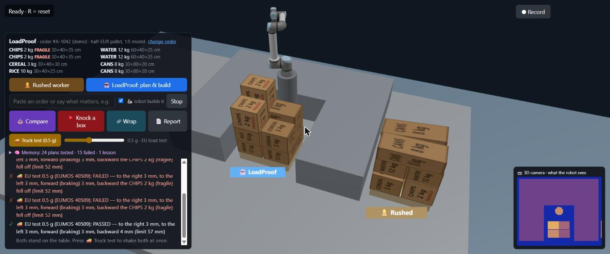

# LoadProof — prove the pallet before the truck leaves

**Usable today with a phone, ready for robots tomorrow.**
An AI loading agent for warehouses: it plans how to stack a pallet, proves the plan in a physics truck simulation
before a single box is touched, decides how to secure it, and then a person (with a step-by-step loading sheet on the
phone) or a robot cell builds it.

Team **Baxtiyor** (Abdurakhmon, Alyor) · GDG on Campus Debrecen — Agentic AI Hackathon, 21 November 2026.

**▶ Demo video (1:42):** [pitch/loadproof-demo.mp4](pitch/loadproof-demo.mp4) — the agent plans and tests, the robot
builds with its 3D camera, then the truck test: the rushed pallet falls, LoadProof's holds. **Deck (PDF):**
[pitch/LoadProof_pitch_deck.pdf](pitch/LoadProof_pitch_deck.pdf)



## The problem

- Up to 25% of truck accidents are linked to badly secured cargo ([European Commission](https://road-safety.transport.ec.europa.eu/eu-road-safety-policy/priorities/safe-vehicles/cargo-securing-and-abnormal-loads_en)).
- Poor pallet wrapping causes about $388 million of product damage a year; 14% of pallets in the study lacked enough wrap ([MH&L, CSCS study for Dow](https://www.mhlnews.com/transportation-distribution/article/22033197/poor-wrapping-can-cost-388-million)).
- 60% of companies learn about shipment damage only after delivery, or never ([Tive, 2025](https://www.supplychain247.com/article/tive-report-most-companies-still-flying-blind-on-shipment-damage)).
- The EU load test (EUMOS 40509) is done in a lab, after the pallet exists. Pallet planning software checks geometry,
  not what the load does when the truck brakes.

## What it does

1. **Boxes in, from a phone** (`boxes.html`): name, fragility (soft / mid / hard), footprint on the 60 × 40 module,
   height, weight. Each box gets a number and a printable label with a QR code; scanning it opens the box's page (what
   is inside, its step on the loading sheet).
2. **An agent that uses tools** (Gemini function calling). It never places boxes itself; it calls tools and decides:
   - `plan_pallet` — a search finds stackings that pass the warehouse rules (full support, heavy low, nothing on fragile
     boxes, "mid" boxes carry only lighter ones);
   - `truck_test` — the MuJoCo physics engine pushes the stacked pallet four ways in a row, like a trip: the EU test
     (0.5 g, EUMOS 40509) and hard braking (0.8 g forward, 0.5 g sideways — road values of EN 12195-1), with or
     without stretch wrap; pass = no box moves more than 5% of the load height;
   - `straps_needed` — top-over straps for the truck floor (EN 12195-1; our code reproduces the worked example of the
     CARING cargo calculator, `node tests/securing.mjs`);
   - `build_pallet` — a person or the robot builds it.
   When a test fails it tries another arrangement or wraps; when no stacking exists it names the box for a second
   pallet. It finishes with a plain-English note using only the tools' numbers. Without the AI (`?noai`, or no answer),
   fixed steps call the same tools.
3. **The loading sheet** on the phone remote (`remote.html`): step by step which box goes where, then wrap and straps;
   tick each step. Also in the printable proof report.
4. **The robot cell (digital twin)**: a 1:5 UR10e (MuJoCo Menagerie model) with a vacuum gripper on a pedestal, a raised
   infeed and a simulated 3D camera.
   - The robot finds each box in the depth picture (2 mm noise), not from the simulation.
   - The vacuum cup seals only on a box top and holds up to 339 N (assumed 0.6 bar, 12 cm cup, safety factor 2); a 20 kg
     box needed 360 N and dropped, as it would.
   - Every move is joint motion (inverse kinematics, smooth acceleration), around the base, above everything on the table.
5. **People stay in control**: worker mode (you choose the box and the spot; LoadProof suggests, checks rules and the
   robot's reach before it moves), the phone remote, and Compare against a "rushed worker" stack.

## Results from our own tests

| | LoadProof | Rushed worker (same boxes) |
|---|---|---|
| Demo order, EU test 0.5 g, unwrapped | passes (1 mm) | falls; breaks 7 warehouse rules |
| Demo order, hard braking 0.8 g, wrapped | passes (1 mm) | fails; 7 rule problems (12 kg on fragile chips) |
| Our 6 demo boxes + 2 random boxes (7 cases) | 6 pass, 1 "move this box to a second pallet" | falls or fails in all 7 |

A real Gemini run read *"2 boxes of canned beans, a sack of rice … 2 bags of chips (they crush easily!), long motorway
trip"* into 8 catalogue boxes, found the EU test failing unwrapped, chose stretch wrap, passed both tests, counted 1
strap, and the robot built it with every box within 5 mm.

## Run it

Node 24.

```
npm install
echo VITE_GEMINI_API_KEY=your-key > .env.local      # optional: without it, add ?noai
npx vite --port 5173
```

- Laptop: `http://localhost:5173` (`?noai` = no Gemini; `?hand` = the first version with a robot hand).
- Phone on the same network: the address shown under the buttons (`…/remote.html`), and `…/boxes.html`.
- Examples: [`examples/`](examples/README.md) — `node tools/load_examples.mjs` loads our 6 demo boxes.

Tests (Node, same physics, no browser): `node tests/securing.mjs`, `node tests/load_agent.mjs` (`AI=1` uses Gemini),
`node tests/worker.mjs`, `node tests/compare_wrapped.mjs 0.8`, `node tests/explore_orders.mjs "<order>"`.

## Honest limits

- A simulation and a planning check, not a certification. One half pallet, at most 9 boxes, on the 60 × 40 module.
- The film is ideal (holds each box to its spot); the cup values are assumed; the arm's own weight is compensated ideally.
- The final "measured" check after each box uses the simulation's positions; a real cell would rescan with the camera.
- LoadProof trusts the box data (weight, size); a real cell adds a scale on the conveyor.
- UR10e payload is 12.5 kg (UR datasheet): heavier boxes need a bigger arm (UR20) or a person.

## Tools we used

- **AI coding assistant: Claude Code (Anthropic)** wrote most of the code from our instructions; we chose the
  direction, tested every step, and found and reported the bugs (for example the robot pushing boxes, the wrong
  label numbers, the truck test that was too soft).
- **Google Gemini API** (gemini-3.5-flash-lite / gemini-3.8-flash): reads free-text orders and runs the agent
  through function calling. Without it, fixed steps call the same tools.
- **MuJoCo 4 (WebAssembly)** for the physics, **three.js** for drawing, **Vite** dev server (it also relays the phone
  remote and keeps the box list), **MediaPipe** (only in the first, robot-hand version), **qrcode-generator**.
- Models: UR10e and Shadow Hand from **MuJoCo Menagerie**.

## When it was built (from the git history)

- **Before the hackathon started (the evening of 20 November and the morning of 21 November, 34 commits):** the
  first version with a robot hand, the Gemini planner, the physics checks and truck test, Compare, the report, and
  the UR10e cell.
- **During the hackathon (from 11:00 on 21 November, 27 commits):** the agent that works through tools, the honest
  vacuum cup, the 3D camera, the truck tests with EN 12195-1 road values, the strap count, worker mode, the phone
  remote, your own boxes with QR labels and the loading sheet, the fixes from our tests, this README.

## Credits

[MuJoCo](https://github.com/google-deepmind/mujoco) and [MuJoCo Menagerie](https://github.com/google-deepmind/mujoco_menagerie)
(UR10e, Shadow Hand; Apache 2.0, licences in `public/models/*/LICENSE`), [MediaPipe](https://github.com/google-ai-edge/mediapipe)
(hand landmarker, Apache 2.0), [three.js](https://threejs.org) (MIT), [qrcode-generator](https://github.com/kazuhikoarase/qrcode-generator)
(MIT), Google Gemini. Formulas: EN 12195-1:2010 as used in the CARING Cargo Calculator (University of Turku).
